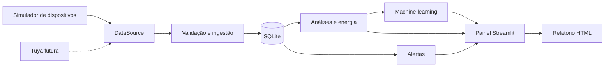

# Sistema IoT para Monitoramento de Ambiente e Predição de Consumo Energético

Projeto Integrador universitário em Python. O sistema acompanha um cômodo pequeno em
Mauá/SP com **três termo-higrômetros** (temperatura e umidade) e **um disjuntor
inteligente** que mede o circuito de quatro lâmpadas LED de 15 W. As leituras são
gravadas em SQLite, analisadas, comparadas com limites de alerta e usadas para prever
o consumo de energia dos próximos dias com machine learning. Tudo é apresentado em um
painel web feito com Streamlit.

**Origem dos dados:** nesta versão os dispositivos são simulados por software. O
simulador gera leituras realistas (clima de Mauá, rotina de uso das lâmpadas, eventos
anormais) no mesmo formato que um dispositivo real entregaria. A arquitetura já separa
a fonte de dados do resto do sistema, para que a troca por dispositivos Tuya reais
exija apenas um novo adaptador (veja [docs/TUYA.md](docs/TUYA.md)).

## Sumário

- [O que o painel mostra](#o-que-o-painel-mostra)
- [Como rodar no computador](#como-rodar-no-computador)
- [Publicação no Railway](#publicação-no-railway)
- [Configuração](#configuração)
- [Arquitetura](#arquitetura)
- [Como funciona](#como-funciona)
- [Testes e solução de problemas](#testes-e-solução-de-problemas)
- [Limitações](#limitações)

## O que o painel mostra

O menu lateral tem seis telas. Um único filtro de datas e dispositivo vale para todas.

| Tela | Conteúdo |
| --- | --- |
| Resumo executivo | Indicadores medidos (temperatura, umidade, consumo, potência, tensão, corrente, alertas), previsões e custos, erros do modelo e potência instalada |
| Ambiente e histórico | Gráfico de temperatura, umidade ou potência por sensor e estatísticas do período |
| Energia | Consumo diário e potência do circuito |
| Alertas | Ocorrências fora dos limites, com nível Atenção ou Crítico |
| Previsão energética | Previsão diária com faixa de erro, comparação com o consumo medido e geração de relatório HTML |
| Equipamentos | Cadastro de novas cargas no circuito (nome, quantidade e potência) |

## Como rodar no computador

Requisitos: Python 3.12 ou superior, pip e venv. Internet só é necessária para instalar
os pacotes. Execute os comandos na pasta deste README.

### Instalação e demonstração rápida (PowerShell)

```powershell
python -m venv .venv
.\.venv\Scripts\python.exe -m pip install -r requirements.txt
Copy-Item .env.example .env
.\.venv\Scripts\python.exe scripts/setup_demo.py --days 60
.\.venv\Scripts\python.exe -m streamlit run app/dashboard/app.py
```

Abra http://localhost:8501. Ctrl+C encerra. Linux/macOS: use `python3 -m venv .venv`,
`.venv/bin/python` nos comandos e `cp .env.example .env`.

`setup_demo.py` prepara tudo de uma vez: gera o histórico (30 a 90 dias; padrão 60),
incluindo o dia atual parcial e eventos anormais, sincroniza os alertas, compara os
modelos, treina, gera a previsão e o relatório. **Ele recria as tabelas de leituras e
alertas**: pare o coletor antes. Se o banco já tiver dados, uma cópia é salva em
`data/backups/` antes; se o backup falhar, nada é apagado. Para restaurar, pare os
processos e copie o backup desejado para o caminho do banco.

Versão compacta com **exatamente 5.000 leituras** (1.250 por dispositivo, um instante
a cada ~39 minutos):

```powershell
.\.venv\Scripts\python.exe scripts/setup_demo.py --days 33 --records 5000
```

Para repetir exatamente as versões testadas, instale `requirements-lock.txt` no lugar
de `requirements.txt` (registrado em Windows com Python 3.14).

### Coleta contínua

Em outro terminal, com o painel aberto:

```powershell
.\.venv\Scripts\python.exe scripts/run_collector.py
```

A cada intervalo (60 s por padrão) o coletor gera e valida uma leitura de cada
dispositivo, grava no banco, atualiza alertas, avalia previsões de dias que terminaram,
retreina o modelo de aprendizado contínuo e gera o relatório semanal quando uma semana
fecha. `--once` faz uma única coleta, útil para teste. O painel não se atualiza
sozinho: recarregue a página ou mude um filtro para ver as leituras novas.

### Passo a passo manual

Para montar um banco novo sem `setup_demo.py`:

```powershell
.\.venv\Scripts\python.exe -m scripts.init_db
.\.venv\Scripts\python.exe scripts/generate_history.py --days 60
.\.venv\Scripts\python.exe scripts/evaluate_baselines.py
.\.venv\Scripts\python.exe scripts/train_model.py
.\.venv\Scripts\python.exe scripts/predict.py
.\.venv\Scripts\python.exe scripts/generate_report.py
```

Datas fixas, em outro banco: `generate_history.py --days 60 --start 2026-01-01
--interval-minutes 15` e `generate_report.py --end 2026-03-02` (`--end` é exclusivo; o
relatório cobre os sete dias anteriores). Janelas de histórico sobrepostas são
rejeitadas.

### Exportações em HTML

| Comando | Resultado |
| --- | --- |
| `scripts/export_share_page.py` | `exports/monitoramento_compartilhar.html`: página leve, só de consulta, adaptada a celular. Carrega os gráficos de um CDN, então precisa de internet |
| `scripts/export_site_html.py` | `exports/monitoramento_comodo.html`: cópia completa que funciona sem internet. Cadastros feitos nela ficam só no navegador |

As duas guardam os dados do momento da exportação; gere de novo para atualizar.

## Publicação no Railway

O repositório já vem pronto para o [Railway](https://railway.com). O site e o coletor
rodam juntos em um único serviço, porque no Railway cada volume só pode ser ligado a um
serviço e os dois precisam do mesmo banco.

| Arquivo | Função |
| --- | --- |
| `railway.json` | Comando de inicialização e verificação de saúde em `/_stcore/health` |
| `scripts/railway_start.sh` | Liga `models/`, `reports/` e `logs/` ao volume, cria o histórico no primeiro deploy, inicia o coletor em segundo plano e o Streamlit na porta `$PORT` |
| `.python-version` | Fixa o Python 3.12 no build |
| `.gitattributes` | Mantém o script com quebras de linha do Linux |

Passo a passo:

1. No Railway, **New Project** → **Deploy from GitHub repo** → escolha este repositório.
2. No serviço, **Add Volume** com o caminho de montagem `/data`. Sem o volume, os dados
   são recriados a cada deploy.
3. **Settings** → **Networking** → **Generate Domain**, aceitando a porta sugerida.
4. Acompanhe em **Deployments** → **View Logs**. O primeiro deploy leva de 1 a 3 minutos
   para gerar os dados; o site está no ar quando aparecer "You can now view your
   Streamlit app".

Variáveis opcionais, na aba **Variables**: qualquer item da tabela de
[Configuração](#configuração) e `INITIAL_DAYS` (dias de histórico do primeiro deploy,
padrão 60). O serviço fica ligado o tempo todo, então consome crédito do plano
continuamente.

## Configuração

Ordem de prioridade: variáveis do processo, depois o arquivo `.env` na raiz, depois os
padrões abaixo. Números usam ponto decimal. O `.env` não vai para o Git.

| Variável | Padrão | Uso |
| --- | --- | --- |
| DATABASE_URL | sqlite:///data/monitoramento.db | Arquivo SQLite; caminhos relativos partem da raiz |
| DATA_SOURCE | simulator | `tuya` está reservado e ainda indisponível |
| SIMULATION_SEED | 42 | Semente que torna a simulação reproduzível |
| SIMULATION_INTERVAL_SECONDS | 60 | Intervalo do coletor |
| ENERGY_PRICE_KWH | 0.78938 | Tarifa Enel SP residencial convencional, R$/kWh |
| LAMP_COUNT / LAMP_POWER_W | 4 / 15 | Lâmpadas do circuito e potência de cada uma (W) |
| USAGE_HOURS_MIN / USAGE_HOURS_MAX | 8 / 10 | Faixa de horas de uso nos dias úteis |
| TEMPERATURE_MIN / TEMPERATURE_MAX | 18 / 30 | Limites de alerta em °C |
| HUMIDITY_MIN / HUMIDITY_MAX | 40 / 70 | Limites de alerta em % |
| TUYA_ACCESS_ID / TUYA_ACCESS_SECRET / TUYA_ENDPOINT / TUYA_DEVICE_IDS | vazio | Reservados para a integração futura; não coloque credenciais aqui |

Horários usam o fuso **America/Sao_Paulo** e são gravados sem offset.

**Tarifa:** consultada em 04/10/2026 na
[Enel São Paulo](https://www.enel.com.br/pt-saopaulo/Para_Voce/tarifa-energia-eletrica.html),
classe B1 residencial convencional, vigente desde 04/07/2026: TUSD 472,42 + TE 316,96
R$/MWh = 0,78938 R$/kWh. Não inclui impostos, bandeiras, iluminação pública nem valores
mínimos da ligação. Atualize no `.env` quando a tarifa mudar.

## Arquitetura



```text
app/
  config.py                 Configuração validada e horário local
  logging_config.py         Logs rotativos e tratamento de erros dos comandos
  presentation.py           Rótulos em português e tema dos gráficos
  data_sources/             Contrato de leitura, simulador, clima de Mauá, adaptador Tuya futuro
  database/                 Conexão, tabelas e consultas
  services/
    ingestion.py            Coleta e geração de histórico
    analytics.py            Estatísticas, consumo e gráficos
    energy.py               Custos e projeção mensal
    alerts.py               Regras de alerta e intervalo mínimo entre ocorrências
    equipment.py            Cadastro de equipamentos
    dynamic_usage.py        Rotina de ocupação do cômodo
    lighting.py             Carga das lâmpadas
    reports.py              Relatório HTML
    maintenance.py          Rotinas executadas pelo coletor
    demo.py                 Preparação completa da demonstração
  ml/
    features.py             Dataset diário e divisão temporal
    evaluate.py             Modelos de referência e métricas
    train.py                Treinamento e seleção do modelo
    predict.py              Previsão a partir do modelo salvo
    learning.py             Aprendizado contínuo com novas leituras
  dashboard/
    app.py                  Painel principal e navegação
    forecast.py             Tela de previsão
    learning.py             Avaliação das previsões anteriores
    equipment.py            Tela de equipamentos
    share_page.html         Modelo da página de compartilhamento
    site_export.html        Modelo da cópia offline
scripts/                    Comandos de operação, exportação e inicialização no Railway
tests/                      Testes pytest e Streamlit AppTest
docs/                       Integração Tuya, registro das etapas e validação
data/ models/ reports/      Banco, modelos e relatórios gerados (fora do Git)
```

## Como funciona

### Dispositivos e energia

- **Sensores (sensor_01 a sensor_03):** a temperatura combina o ciclo diário, variação
  entre dias, diferença de posição de cada sensor e ruído suave, partindo das médias
  climatológicas mensais de Mauá/SP ([Climatempo](https://www.climatempo.com.br/climatologia/488/maua-sp),
  consultada em 04/10/2026; setembro 15–23 °C, outubro 16–24 °C), com +1 °C e amplitude
  20% menor por ser um ambiente fechado. A umidade varia de forma inversa à temperatura.
  A cada ~17 dias ocorre um evento térmico anormal.
- **Disjuntor inteligente (energy_meter_01):** mede potência, tensão (~220 V), corrente
  (P/V, fator de potência unitário) e o contador acumulado de energia. Nos dias úteis há
  seis períodos de ocupação que somam de 8 a 10 horas; dentro deles as lâmpadas ligam
  de forma independente, em blocos de 15 a 50 minutos, então a potência varia entre 0
  e 60 W. Aos sábados o uso termina às 12h; aos domingos não há consumo. Equipamentos
  cadastrados entram nesse mesmo perfil a partir da data do cadastro.
- **Cálculo de consumo:** o consumo é a diferença entre leituras do contador. Intervalos
  maiores que 1 hora, contadores que diminuem e intervalos inválidos são descartados e
  reduzem a cobertura; ausência de leitura nunca vira consumo zero. Intervalos que
  atravessam horas ou dias são divididos proporcionalmente.
- **Custos:** `custo = consumo_kWh × tarifa`. A projeção mensal usa a média dos dias
  completos do filtro × dias do mês da data final × tarifa.

### Alertas

- Temperatura e umidade fora dos limites geram alerta (igualdade não alerta). Desvio de
  pelo menos 5 °C ou 10 pontos percentuais é **Crítico**; os demais são **Atenção**.
- Potência elevada: acima do maior valor entre 1,8 × média, média + 3 desvios padrão
  das 24 h anteriores e 500 W, com pelo menos 24 amostras anteriores.
- Cada dispositivo e tipo de alerta tem um intervalo mínimo de 6 horas entre ocorrências.

### Machine learning

1. **Alvo:** consumo de cada dia completo. Dias parciais e janelas com lacunas ficam de fora.
2. **Variáveis:** dia da semana, fim de semana, seno/cosseno semanal, consumo de 1, 2 e 7
   dias antes, média dos 7 dias anteriores e temperatura, umidade e potência do dia anterior.
3. **Divisão cronológica** aproximada de 60/20/20 (treino, validação, teste). São
   necessárias ao menos 21 linhas utilizáveis: gere no mínimo 30 dias, de preferência 60–90.
4. **Candidatos:** dois modelos de referência (consumo do dia anterior e média de 7 dias),
   Linear Regression, Random Forest e Gradient Boosting.
5. **Avaliação:** em blocos de até 7 dias, usando as próprias previsões como entrada dos
   dias seguintes do bloco, como aconteceria na prática.
6. **Seleção:** menor erro absoluto médio (MAE) na validação, com RMSE como desempate. Um
   modelo de referência pode vencer. Depois de avaliado, o modelo final é treinado com
   todo o histórico.

MAE é o erro médio em kWh/dia; RMSE dá mais peso aos erros grandes. A faixa mostrada
nos gráficos usa o percentil 90 dos erros observados; é uma referência descritiva, não
um intervalo de confiança calibrado.

**Aprendizado contínuo:** a tabela `forecasts` registra cada previsão emitida. Quando um
dia termina, o coletor compara a previsão com o consumo medido, retreina um Random
Forest com até 14 dias recentes e emite as previsões dos 7 dias seguintes. Previsões
antigas nunca são sobrescritas, o que permite acompanhar o erro ao longo do tempo. Na
preparação da demonstração esse ciclo é reproduzido sobre o histórico, com as emissões
marcadas como `historical_replay`.

Carregue somente arquivos `.joblib` gerados pelo próprio projeto: o formato executa
código ao ser aberto.

### Relatório

Arquivo HTML independente com período, temperatura, umidade, leituras fora da faixa,
energia, custos, cobertura, alertas (até 20 detalhados) e previsão. O botão na tela de
previsão gera o relatório do filtro atual e oferece o download; o navegador pode
salvá-lo em PDF.

## Testes e solução de problemas

```powershell
.\.venv\Scripts\python.exe -m pytest -q
.\.venv\Scripts\python.exe -m pip check
```

São 73 testes, com sementes fixas, bancos temporários e Streamlit AppTest. Não usam
internet nem alteram o banco da demonstração.

| Situação | O que fazer |
| --- | --- |
| Banco vazio | Execute `setup_demo.py` ou gere o histórico |
| Banco indisponível | Confira `DATABASE_URL` e as permissões da pasta |
| Histórico sobreposto | Use outro banco ou `setup_demo.py` (faz backup antes) |
| Configuração inválida | Use ponto decimal, intervalo positivo e limites coerentes |
| Modelo ausente ou incompatível | Gere pelo menos 30 dias completos e rode `train_model.py` |
| Leituras antigas | Rode `setup_demo.py` ou deixe o coletor ligado |
| `DATA_SOURCE=tuya` | Use `simulator`; a integração real ainda não existe |
| Porta 8501 ocupada | Acrescente `--server.port 8502` ao comando do Streamlit |

Logs ficam em `logs/app.log`, com rotação automática e sem dados sensíveis.

## Limitações

- Os dados são simulados; os modelos não foram validados com medições reais do cômodo.
- Não há autenticação: quem acessa o painel publicado pode cadastrar equipamentos.
- SQLite atende à demonstração; volume alto ou muitos acessos simultâneos exigiriam outro banco.
- Sem migrações de schema e sem suporte a vários estabelecimentos.
- O coletor só registra leituras enquanto está em execução e não reconstrói períodos parados.

Mais detalhes: [docs/ETAPAS.md](docs/ETAPAS.md) (implementação por etapas),
[docs/VALIDACAO.md](docs/VALIDACAO.md) (validações executadas) e
[docs/TUYA.md](docs/TUYA.md) (integração com dispositivos reais).
