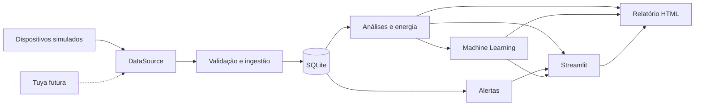

# Sistema IoT em Nuvem para Monitoramento de Ambiente e Predição de Consumo Energético em Estoque Comercial

Projeto Integrador universitário em Python: três termo-higrômetros e um medidor
elétrico simulados, histórico SQLite, análises, alertas, relatório semanal e
previsão de consumo em um dashboard Streamlit.

**Cenário atual:** cômodo residencial pequeno em Mauá/SP, com somente quatro
lâmpadas LED de 15 W acompanhadas por um disjuntor inteligente, com uso dinâmico. O perfil elétrico comercial foi
substituído por essa iluminação; temperatura e umidade mantêm o perfil de Mauá.
As três posições de sensores permanecem para comparação ambiental.

**Todos os dados são simulados.** Não há dispositivos físicos, credenciais reais,
chamadas à Tuya nem serviços pagos. O nome descreve a proposta acadêmica; esta
implementação executa localmente, preparada para uma fonte remota futura. Não
houve implantação em nuvem. Modelos sintéticos não estão validados para prever
consumo real do estabelecimento.

## Requisitos

Python 3.12+, pip e venv. Ambiente validado: Windows com Python 3.14. Internet é
necessária apenas para instalar os pacotes; execução e testes são locais. SQLite
já vem com o Python. Execute os comandos na pasta deste README.

Bibliotecas: SQLAlchemy, python-dotenv, pandas, NumPy, Plotly, Streamlit,
scikit-learn, joblib, tzdata e pytest. Os gráficos usam Plotly; Matplotlib não é
necessário. PDF automático não foi incluído; o HTML pode ser impresso no navegador.

## Instalação e apresentação rápida

PowerShell, sem ativar o ambiente virtual:

```powershell
python -m venv .venv
.\.venv\Scripts\python.exe -m pip install -r requirements.txt
Copy-Item .env.example .env
.\.venv\Scripts\python.exe scripts/setup_demo.py --days 60
.\.venv\Scripts\python.exe -m streamlit run app/dashboard/app.py
```

Abra [o dashboard local](http://localhost:8501). Ctrl+C encerra o processo. Se já
houver `.env`, preserve-o em vez de copiar novamente.

**setup_demo.py recria as tabelas de leituras e alertas. Pare o coletor antes.**
Se o banco contiver dados, cria primeiro uma cópia SQLite consistente em
`backups/`, dentro da pasta do banco. Se o backup falhar, não recria as tabelas.
Outros arquivos não são apagados. Para restaurar, pare os processos e copie o
backup escolhido para o caminho do banco.

A demonstração aceita 30–90 dias; 60 é o padrão. Gera também o dia atual parcial,
eventos anormais, indicadores, comparação de modelos, previsão e relatório.
Reexecutar regenera os dados com a seed configurada; o instante final muda.

Para a versão compacta com **exatamente 5.000 leituras** (1.250 por dispositivo):

```powershell
.\.venv\Scripts\python.exe scripts/setup_demo.py --days 33 --records 5000
```

Em 04/10/2026 esse comando cobre 01/09/2026 até o horário da execução. Os instantes
são igualmente espaçados, com intervalo aproximado de 39 minutos, preservando os
dias completos para análise e treinamento. O total conta as quatro leituras de
cada instante, não 5.000 instantes. O coletor acrescentará novas leituras se for
iniciado; não há descarte automático para manter o total fixo.

Para repetir as versões validadas, instale `requirements-lock.txt` em vez de
`requirements.txt`. O primeiro registra também dependências transitivas do
ambiente Windows/Python 3.14 testado; a disponibilidade de wheels pode variar
por plataforma. O segundo declara faixas compatíveis.

Linux/macOS: use `python3 -m venv .venv`, `.venv/bin/python` nos comandos seguintes
e `cp .env.example .env`. A execução foi validada no Windows.

## Fluxo manual

Para um banco novo, sem usar setup_demo:

```powershell
.\.venv\Scripts\python.exe -m scripts.init_db
.\.venv\Scripts\python.exe scripts/generate_history.py --days 60
.\.venv\Scripts\python.exe scripts/evaluate_baselines.py
.\.venv\Scripts\python.exe scripts/train_model.py
.\.venv\Scripts\python.exe scripts/predict.py
.\.venv\Scripts\python.exe scripts/generate_report.py
.\.venv\Scripts\python.exe -m streamlit run app/dashboard/app.py
```

O histórico termina na meia-noite de hoje. Para datas fixas, em outro banco:

```powershell
.\.venv\Scripts\python.exe scripts/generate_history.py --days 60 --start 2026-01-01 --interval-minutes 15
.\.venv\Scripts\python.exe scripts/generate_report.py --end 2026-03-02
```

`--end` é exclusivo: o relatório cobre os sete dias anteriores. Janelas históricas
sobrepostas são rejeitadas. Use outra `DATABASE_URL` ou setup_demo para reiniciar.
É possível anexar histórico a partir da última leitura; gaps maiores que uma
hora ficam sem cobertura energética válida.

## Coleta automática

Em outro terminal, com o dashboard aberto:

```powershell
.\.venv\Scripts\python.exe scripts/run_collector.py
```

Uma coleta isolada para teste:

```powershell
.\.venv\Scripts\python.exe scripts/run_collector.py --once
```

O coletor valida cada leitura, armazena as válidas, atualiza alertas e verifica o
relatório semanal. Restaura o contador simulado do último registro. Erros são
registrados e há nova tentativa após o intervalo configurado; `--once` retorna
erro quando a operação falha. A fonte Tuya ainda não implementada encerra com
mensagem explícita. Ctrl+C encerra normalmente.

O relatório automático cobre a última semana fechada de segunda a domingo,
uma vez por semana/banco, quando há histórico cobrindo as fronteiras. O processo
precisa estar em execução: não é um serviço do Windows nem agendamento do sistema.
O relatório manual e o botão do dashboard usam os sete dias completos anteriores
a hoje. O coletor não treina o modelo automaticamente.

## Configuração

Precedência: variáveis do processo > `.env` na raiz > padrões. Números usam ponto
decimal. `.env` e artefatos locais são ignorados no Git.

| Variável | Padrão | Uso |
| --- | --- | --- |
| DATABASE_URL | sqlite:///data/monitoramento.db | Arquivo SQLite |
| DATA_SOURCE | simulator | tuya está reservado e indisponível |
| SIMULATION_SEED | 42 | Seed inteira |
| SIMULATION_INTERVAL_SECONDS | 60 | Intervalo positivo do coletor |
| ENERGY_PRICE_KWH | 0.78938 | Enel SP residencial convencional, R$/kWh |
| LAMP_COUNT | 4 | Quantidade de lâmpadas |
| LAMP_POWER_W | 15 | Potência por lâmpada, W |
| USAGE_HOURS_MIN | 8 | Limite inferior da atividade diária sintética |
| USAGE_HOURS_MAX | 10 | Limite superior da atividade diária sintética |
| TEMPERATURE_MIN / TEMPERATURE_MAX | 18 / 30 | Limites em °C |
| HUMIDITY_MIN / HUMIDITY_MAX | 40 / 70 | Limites em % |
| TUYA_ACCESS_ID / TUYA_ACCESS_SECRET | vazio | Reservados, sem uso real |
| TUYA_ENDPOINT / TUYA_DEVICE_IDS | vazio | Reservados para o adaptador futuro |

Aceita URLs SQLite simples e `sqlite:///:memory:` para testes. Caminhos relativos
são resolvidos na raiz, sem caminhos específicos do computador no código.
A pasta do banco é criada automaticamente. Importar módulos não cria o banco;
reinicializar preserva os registros.

Horários usam **America/Sao_Paulo**, persistidos sem offset. Essa convenção deve
ser revisada para operações em vários fusos e séries com horário de verão.

## Arquitetura e arquivos



```text
app/
  config.py                 Configuração validada e horário local
  logging_config.py         Logs rotativos e erros de CLI
  data_sources/
    readings.py             Contrato e validação de leituras
    base.py                 Interface abstrata DataSource
    simulator.py            Simulador temporal
    factory.py              Seleção da fonte
    tuya.py                 Adaptador futuro, sem rede
  database/
    connection.py           Engine e inicialização
    models.py               Tabelas de leituras e alertas
    repository.py           Inserção, consultas e agregações
  services/
    ingestion.py            Coleta, restauração e histórico
    analytics.py            Estatísticas, consumo e gráficos
    energy.py               Custos e projeção mensal
    alerts.py               Regras, cooldown e persistência
    reports.py              Relatório HTML
    maintenance.py          Rotinas do coletor
    demo.py                 Demonstração completa
  ml/
    features.py             Dataset e divisão temporal
    evaluate.py             Baselines, métricas, recursão
    train.py                Treinamento e seleção
    predict.py              Previsão e verificação do histórico
  dashboard/
    app.py                  Indicadores e histórico
    forecast.py             Previsões e métricas explicadas
scripts/                    Comandos operacionais
tests/                      Pytest e Streamlit AppTest
docs/                       Integração Tuya e validação das etapas
data/                       SQLite e backups
models/                     Joblib, metadados JSON e previsão CSV
reports/                    HTML e resumo da demonstração
logs/                       app.log e até 3 arquivos rotacionados
.streamlit/config.toml      Tema, servidor local, telemetria desativada
```

## Simulação, análises e energia

Dispositivos: sensor_01, sensor_02, sensor_03 e energy_meter_01. Temperatura combina
ciclo diário, variação lenta entre dias, diferenças de posição e ruído suave.
Umidade varia inversamente com temperatura. Eventos térmicos anormais aparecem
aproximadamente a cada 17 dias. A carga elétrica é exclusivamente das lâmpadas,
com acionamentos parciais próximos de 15/30/45/60 W e períodos sem carga.
Corrente = potência/tensão, assumindo fator de potência unitário nesta demonstração.

O perfil térmico usa as médias climatológicas mensais de Mauá/SP, interpoladas
para evitar saltos entre meses. Para setembro, a referência externa é mínima média
de 15 °C e máxima média de 23 °C; para outubro, 16 °C e 24 °C.
[Referência: Climatempo](https://www.climatempo.com.br/climatologia/488/maua-sp),
consultada em 04/10/2026. São médias históricas, não medições de setembro/outubro
de 2026. Para o estoque, assumimos +1 °C, amplitude diária 20% menor, pequenas
diferenças entre sensores e variações meteorológicas suaves. Eventos de aquecimento
podem superar as médias. A umidade é uma hipótese sintética associada à temperatura,
não foi calibrada com uma série observada local. Parâmetros em data_sources/climate.py
e simulator.py. Modelos e relatórios precisam ser regenerados após alterar esse perfil.

O simulador integra exatamente o tempo em que as lâmpadas ficam ligadas, inclusive
quando o intervalo de amostragem atravessa o horário de acendimento ou desligamento.
O primeiro registro é referência zero. A análise calcula diferenças entre contadores;
não soma energia acumulada.
Intervalos que atravessam horas/dias são divididos proporcionalmente, uma aproximação
uniforme dentro do intervalo. Gaps > 1h, deltas negativos e intervalos inválidos são
excluídos e reduzem a cobertura. Ausência de medição não equivale a consumo zero.

Temperatura/umidade: média, mínimo, máximo, mediana e desvio padrão amostral por sensor.
Energia: potência média/máxima, perfil horário, agregações diárias, semanais e mensais.
`custo = consumo_kWh × tarifa`. Projeção mensal: média dos dias completos disponíveis
nos sete dias anteriores × dias do mês × tarifa. Sem dias completos, fica indisponível.
Sem impostos, bandeiras ou demanda contratada.

Tarifa consultada em 04/10/2026 na [Enel São Paulo](https://www.enel.com.br/pt-saopaulo/Para_Voce/tarifa-energia-eletrica.html):
classe B1 residencial convencional, vigente desde 04/07/2026, TUSD 472,42 + TE
316,96 R$/MWh = **0,78938 R$/kWh**. O valor fica no `.env`, com funcionamento
offline; não há consulta automática a futuros reajustes. Atualize a configuração
conforme a tarifa aplicável da conta. Impostos, bandeiras, iluminação pública e
valores mínimos da ligação não são atribuídos exclusivamente a esse cômodo.

O disjuntor representa o consumo total do circuito. Nos dias úteis são geradas seis
sessões de ocupação com duração total entre 8 e 10 horas e pausas variáveis.
Aos sábados, as sessões são encerradas até as 12h; aos domingos, não há consumo. Dentro das sessões, as unidades podem ligar de forma
independente, em blocos variáveis de 15 a 50 minutos. A potência varia de zero a
60 W no cenário das quatro lâmpadas, com até 3% de diferença abaixo do nominal.
O tempo de atividade do circuito não equivale a quatro lâmpadas ligadas durante
todo esse tempo. A energia é a integral exata desses segmentos; trocar a frequência
de coleta não muda o consumo acumulado. Tensão varia em torno de 220 V; corrente
usa P/V como simplificação de fator de potência unitário. São hipóteses sintéticas,
não especificações de um fabricante. O painel estima horas ativas por interpolação
entre leituras; por isso essa estimativa pode diferir da atividade gerada.
Os cálculos mantêm precisão completa; apenas a exibição arredonda para duas casas.


O simulador não reconstrói detalhes de uma longa interrupção do coletor. Para a
apresentação com cobertura contínua até agora, execute setup_demo.py.

## Alertas e interface

Limites ambientais são estritos: igualdade não alerta. Desvios de pelo menos 5 °C
ou 10 pontos percentuais são CRITICAL; demais são WARNING. Potência elevada:
acima do maior entre 1,8 × média, média + 3 desvios padrão das 24h anteriores e 500 W,
com ao menos 24 amostras anteriores. Regra demonstrativa, não diagnóstico elétrico.

Cooldown persistente de seis horas por dispositivo/tipo. Alertas ativos representam
condições na última leitura recente, não todo o histórico. Limite de frescor: maior
entre 30 minutos e dois intervalos de coleta. A data da última leitura permanece visível no cabeçalho.

Filtros de período/dispositivo/variável afetam o histórico ambiental. Indicadores de
energia mantêm os períodos rotulados. Clique em **Atualizar leituras** após novas
coletas: não há atualização automática do navegador nesta versão.

## Machine learning

1. Alvo: consumo diário de dias completos. Dias parciais e janelas com lacunas são
   excluídos, sem substituir ausência por zero ou juntar dias separados.
2. Features: dia da semana, fim de semana, seno/cosseno semanal, lags 1/2/7, média
   móvel dos sete dias anteriores e temperatura/umidade/potência do dia anterior.
   Hora não entra porque a frequência é diária.
3. Divisão cronológica aproximada 60/20/20 após as defasagens. Exige ao menos 21
   linhas utilizáveis: gere 30 dias completos no mínimo, preferencialmente 60–90.
4. Baselines: consumo anterior e média móvel de sete dias. Modelos: LinearRegression,
   RandomForestRegressor e GradientBoostingRegressor, sem redes neurais.
5. Avaliação em blocos recursivos de até sete dias. Dentro de cada bloco, previsões
   alimentam os lags; observações reais entram apenas na origem do próximo bloco.
   Temperatura/umidade futuras repetem a semana anterior; potência média futura
   deriva do kWh previsto. Não são consultadas covariáveis futuras reais.
6. Seleção pelo menor MAE de validação, RMSE no desempate. Um baseline pode vencer.
   Teste medido após refit em treino+validação. Só depois o modelo final é reajustado
   em todos os dias, inclusive teste. Métricas reportadas são da avaliação anterior
   ao ajuste final, não do desempenho dentro da amostra do modelo salvo.

MAE é erro absoluto médio em kWh/dia; RMSE penaliza mais erros grandes. MAPE exclui
alvos zero e é omitido se não houver alvos aplicáveis; o JSON registra essa contagem.
A faixa visual usa o percentil 90 do erro absoluto de validação do modelo escolhido.
É **heurística, sem garantia probabilística**: amostra pequena e usada na seleção,
não um intervalo calibrado de confiança ou de previsão.

O joblib contém modelo e metadados; JSON paralelo registra parâmetros, datas, seed,
features, versão, splits e métricas. A assinatura do histórico impede usar o artefato
após alterar dados antigos ou trocar de base. Treine novamente nesses casos. Carregue
somente joblib produzido localmente pelo projeto, nunca arquivos desconhecidos.

A previsão começa depois do último dia completo, podendo incluir hoje inteiro;
não significa apenas consumo restante de hoje. Datas e aviso de histórico atrasado
são mostrados. O CSV é exportação; a interface recalcula com o histórico atual.

## Relatório semanal

HTML autossuficiente: período, temperatura, umidade, leituras fora da faixa, energia,
custos, cobertura, alertas e previsão quando disponível. Até 20 principais ocorrências
são detalhadas; totais abrangem todo o período. O botão **Gerar relatório semanal**
salva em reports e oferece download. Pode ser impresso em PDF pelo navegador.

## Testes e solução de problemas

```powershell
.\.venv\Scripts\python.exe -m pytest -q
.\.venv\Scripts\python.exe -m pip check
```

Testes usam seeds, dados conhecidos, bancos temporários e AppTest, sem credenciais
ou internet. Não alteram o banco da apresentação. pytest.ini reserva
`.pytest_tmp`, limpa pelo pytest; não salve arquivos próprios nessa pasta.

| Situação | Ação |
| --- | --- |
| Banco vazio | Gere histórico ou execute setup_demo.py |
| Banco indisponível | Confira DATABASE_URL, permissões e inicialização |
| Histórico sobreposto | Use outra base ou setup_demo.py com backup |
| Configuração inválida | Números com ponto, intervalo positivo e limites coerentes |
| Modelo ausente / histórico insuficiente | Gere 60 dias completos e execute train_model.py |
| Modelo incompatível | Treine novamente neste ambiente e com o banco atual |
| Leituras antigas / hoje sem cobertura | Execute setup_demo.py ou mantenha o coletor ativo |
| DATA_SOURCE=tuya | Use simulator; integração real ainda não existe |
| Porta 8501 ocupada | Acrescente --server.port 8502 ao comando Streamlit |

Logs rotativos em logs/app.log. CLIs retornam código não zero em falhas, sem registrar
segredos; dashboard apresenta mensagens amigáveis. Não envia e-mails ou mensagens
externas. Veja docs/TUYA.md, docs/ETAPAS.md e docs/VALIDACAO.md.

## Limitações

A simulação simplifica ambiente, carga e comportamento humano. Não há autenticação,
múltiplos estabelecimentos, migrações de schema, implantação em nuvem nem calibração
real. SQLite atende à apresentação local; alto volume/concorrência exigem revisão.
O dashboard lê o histórico em memória. Energia foi dimensionada para um medidor.
Não há coleta com o processo desligado. Resultados sintéticos não validam previsão real.

### Aprendizado com novas leituras

A tabela SQLite `forecasts` guarda emissão, fim do histórico de treinamento, dia
previsto, previsão, faixa, valor observado e instante de avaliação. O coletor
avalia previsões pendentes quando o dia fica completo; depois treina Random Forest
com até 14 exemplos diários recentes e registra sete novos dias, a partir do dia
seguinte à emissão. A previsão antiga nunca é sobrescrita. A faixa usa o percentil
90 dos erros absolutos dos 14 últimos dias avaliados (última previsão anterior ao
dia), exigindo pelo menos três resultados. Ela é descritiva e não garante cobertura.

`setup_demo.py` entrega o histórico simulado em ordem cronológica à mesma rotina,
marcando as emissões como `historical_replay`: é uma reprodução histórica, não uma
alegação de execução ao vivo naquelas datas. Os artefatos de comparação inicial
continuam separados do modelo de aprendizado contínuo. O erro pode subir ou cair.
Para novos dados, mantenha `scripts/run_collector.py` em execução. Recarregar a
página apenas consulta os registros, não inventa observações.

O filtro único de datas e dispositivo permanece ao navegar entre todas as telas.
Resumo Executivo concentra os indicadores numéricos de ambiente, energia,
previsões e equipamentos. As demais telas apresentam gráficos, tabelas e cadastro.
Ele filtra médias ambientais, energia, custos, alertas e relatórios. Selecionar um
sensor ambiental não inclui as leituras do disjuntor. A projeção mensal usa dias
completos dentro do filtro e o mês da data final. Em Previsão energética, as datas
selecionam os dias previstos, o histórico observado e os erros correspondentes;
o treinamento e as previsões prospectivas registradas permanecem preservados.
Os calendários permitem consultar também as datas futuras com previsão disponível.
Equipamentos mostra as cargas já cadastradas até o fim do período, incluindo as
anteriores que continuam ativas. O limite de umidade de 70% é configuração do
pedido inicial, não uma recomendação técnica validada para o cômodo.

### Cadastro de equipamentos

No menu lateral, escolha **Equipamentos** para adicionar nome, quantidade e
potência nominal. As quatro lâmpadas iniciais já estão incluídas. Não há cadastro
de horário: cargas adicionais participam do perfil dinâmico após `active_from`.
O coletor consulta esses cadastros em cada leitura; previsões se ajustam com novos
dias completos. O cadastro fica em `equipment` e é preservado ao recriar a demo.
As antigas colunas de programação permanecem apenas por compatibilidade de banco
e não influenciam mais leituras, telas ou cálculos. A fonte continua simulada e
não envia comandos a aparelhos físicos.

As explicações das métricas de erro ficam no ícone de ajuda ao lado do indicador.
O aviso textual de leituras desatualizadas foi removido; a data da última leitura
continua visível no cabeçalho.

### Arquivo HTML independente

Execute `.venv\Scripts\python.exe scripts/export_site_html.py` para gerar
`exports/monitoramento_comodo.html`. Abra esse arquivo diretamente no navegador:
os dados e o Plotly estão incorporados, sem depender de internet. Os filtros de
data/dispositivo recalculam os indicadores da cópia; previsões são as que estavam
registradas na exportação. Cadastros adicionados no HTML ficam no navegador e podem
ser baixados como JSON; não são enviados automaticamente ao banco Python.


Atualização do perfil semanal: a regra de sábado até as 12h e domingo sem consumo
se aplica tanto às lâmpadas iniciais quanto às cargas adicionais. Potência e energia
acumulada permanecem consistentes com essa regra. Os gráficos de tensão e corrente
foram retirados da tela; os indicadores numéricos do circuito foram preservados.
